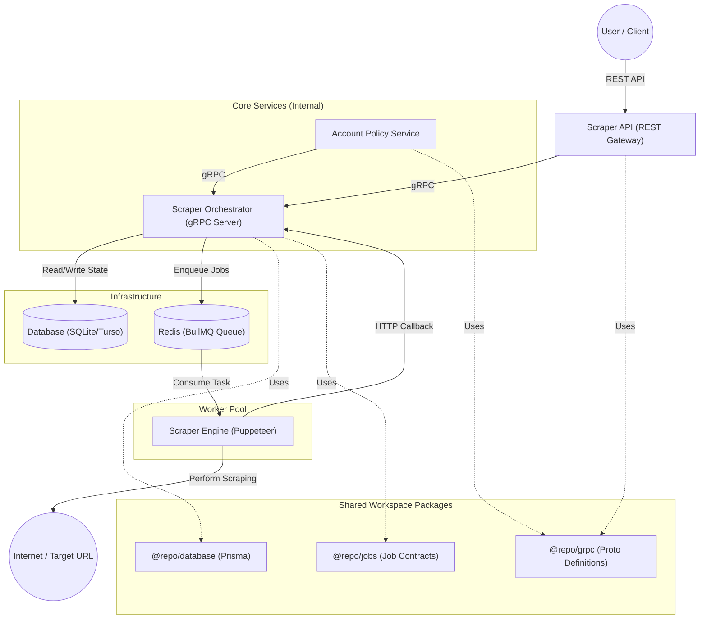

# System Architecture Overview

This document describes the high-level architecture of the scraping platform, featuring a strictly decoupled core services layer utilizing **gRPC**.

## High-Level Diagram

## Component Roles

| Component | Protocol | Responsibility |
| :--- | :--- | :--- |
| **Scraper API** | REST / gRPC | Public gateway. Authenticates users and forwards requests to the Orchestrator via gRPC. |
| **Scraper Orchestrator** | gRPC Server | The "Brain". Owns the DB and Queue. Manages job lifecycle and user status enforcement. |
| **Account Policy Service** | gRPC Client | Monitors billing health (webhooks) and triggers job pausing via Orchestrator when payments fail. |
| **Scraper Engine** | BullMQ / HTTP | Stateless workers that execute scraping tasks. |

## Why gRPC for Internal Services?
- **Strict Contracts**: Using `orchestrator.proto` ensures that the API and Policy services always follow the correct data format.
- **Low Latency**: Binary serialization is more efficient than JSON for high-throughput internal calls.
- **Decoupling**: The REST API doesn't need database or queue drivers; it only needs the gRPC client.
- **Service Independence**: We can update the Orchestrator's internal storage (e.g. swap SQLite for Postgres) without affecting the REST API.

## Account Status Enforcement Flow
1. **Event**: A payment fails (detected by Policy Service).
2. **Signal**: Policy Service calls `UpdateUserStatus(userId, DISABLED)` on the Orchestrator.
3. **Internal Logic**: Orchestrator updates User state in DB and flags all `PENDING` jobs as `PAUSED`.
4. **Resumption**: Once payment is cleared, Policy Service calls `UpdateUserStatus(userId, ACTIVE)`, and the Orchestrator unpauses the jobs.
