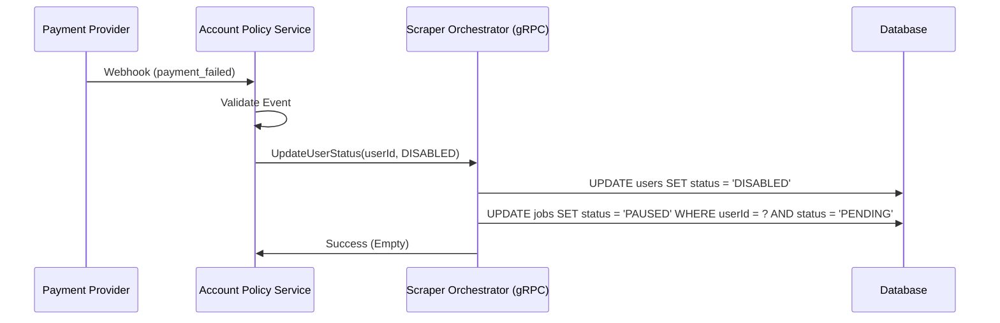

# Account Policy Service Specification

## 1. Overview
The `Account Policy Service` is a background worker responsible for monitoring user account health, billing status, and enforcing system policies. It ensures that only active, paying accounts can utilize the scraping resources.

## 2. Responsibilities
- **Billing Integration**: Acts as the consumer for external payment provider webhooks (e.g., Stripe, Paddle).
- **Status Enforcement**: When a payment fails or a subscription is canceled, it notifies the **Orchestrator** to disable the account and pause pending jobs.
- **Quota Management**: (Future) Monitors consumption against tier limits and throttles accounts.

## 3. Interaction Flow

## 4. Technology Stack
- **Runtime**: Node.js
- **Communication**: gRPC Client (calling Orchestrator)
- **Shared Utils**: `@repo/grpc`, `@repo/logger`

## 5. Deployment
- Deployed as a standalone microservice or a serverless function capable of handling async webhooks.
- Requires high availability to ensure billing events are never missed.
