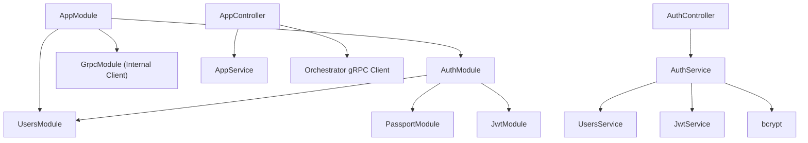
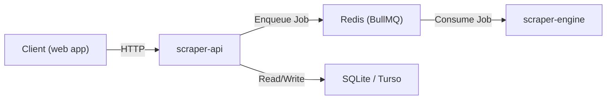

# Scraper API Specification

## 1. Overview
The `scraper-api` is a RESTful backend service built with **NestJS v11**. It serves as the HTTP gateway for the scraping platform, providing user authentication (registration & login) and a protected endpoint to forward scraping jobs to the Orchestrator via **gRPC**. It lives inside a **pnpm monorepo** and depends on shared workspace packages: `@repo/grpc`, `@repo/jobs`, and `@repo/logger`.

> [!NOTE]
> The API no longer manages the database or the queue directly. It communicates with the **Scraper Orchestrator** through the gRPC protocol defined in `@repo/grpc`.

## 2. Architecture

### Pattern
Modular NestJS application following the **Controller → Service → Repository** pattern with dependency injection.

### Module Graph



### Modules

| Module | Responsibility |
| :--- | :--- |
| `AppModule` | Root module. Registers internal gRPC client, `AuthModule`, and `UsersModule`. |
| `AuthModule` | Handles authentication. Imports `PassportModule`, `JwtModule`, and `UsersModule`. Provides `AuthService`, `LocalStrategy`, and `JwtStrategy`. |
| `UsersModule` | Public user profile management. |

### Controllers

| Controller | Prefix | Endpoints |
| :--- | :--- | :--- |
| `AppController` | `/` | `GET /` — Health check. `POST /scrape` — Forward a scrape job to Orchestrator (JWT-protected). |
| `AuthController` | `/auth` | `POST /auth/login` — Authenticate user (Local strategy). `POST /auth/register` — Register a new user. |

## 3. Technology Stack

### Runtime & Language
| Tool | Version / Detail |
| :--- | :--- |
| **Node.js** | 20 (as defined in Dockerfile) |
| **TypeScript** | Target `es2017`, `commonjs` modules |
| **Package Manager** | pnpm (monorepo with `pnpm-workspace.yaml`) |

### Core Framework
| Package | Version | Purpose |
| :--- | :--- | :--- |
| `@nestjs/core` | ^11.0.1 | NestJS core framework |
| `@nestjs/common` | ^11.0.1 | Common NestJS utilities and decorators |
| `@nestjs/platform-express` | ^11.0.1 | Express HTTP adapter |
| `@nestjs/cli` | ^11.0.0 | CLI for building and scaffolding |
| `@nestjs/throttler` | ^6.0.0 | Rate limiting / Throttling |
| `helmet` | ^8.0.0 | HTTP header security |
| `class-validator` | ^0.14.0 | Input validation via decorators |
| `class-transformer` | ^0.5.1 | Object transformation for validation |

### Authentication
| Package | Version | Purpose |
| :--- | :--- | :--- |
| `@nestjs/passport` | ^11.0.5 | Passport integration for NestJS |
| `@nestjs/jwt` | ^11.0.2 | JWT signing and verification |
| `passport` | ^0.7.0 | Authentication middleware |
| `passport-jwt` | ^4.0.1 | JWT strategy for Passport |
| `passport-local` | ^1.0.0 | Local (email/password) strategy for Passport |
| `bcrypt` | ^6.0.0 | Password hashing (salt rounds: 10) |

### Database
| Package | Version | Purpose |
| :--- | :--- | :--- |
| `prisma` | ^7.1.0 | ORM / schema management / migrations (dev dependency) |
| `@prisma/client` | ^7.1.0 | Auto-generated database client |
| `@prisma/adapter-libsql` | ^7.1.0 | LibSQL/Turso adapter for Prisma |
| `@libsql/client` | ^0.15.15 | LibSQL client driver |

- **Database Engine**: SQLite (local dev via `file:./dev.db`), with Turso compatibility via the LibSQL adapter.

### Job Queue
| Package | Version | Purpose |
| :--- | :--- | :--- |
| `@nestjs/bullmq` | ^11.0.4 | BullMQ integration for NestJS |
| `bullmq` | ^5.65.1 | Redis-backed job queue |

- **Queue Name**: `scrape-queue` (from `@repo/jobs`)
- **Job Name**: `scrape-job` (from `@repo/jobs`)
- **Broker**: Redis (via `docker-compose.yml`, image `redis:alpine`)

### Logging
| Package | Purpose |
| :--- | :--- |
| `@repo/logger` (workspace) | Shared Winston-based logger |

The shared logger is wrapped by `AppLogger` (in `src/common/logger/app.logger.ts`), which implements NestJS's `LoggerService` interface and delegates to Winston with `timestamp + level + context + message` formatting.

### Shared Workspace Packages

| Package | Version | Purpose |
| :--- | :--- | :--- |
| `@repo/grpc` | workspace:* | Internal gRPC communication |
| `@repo/jobs` | workspace:* | Shared job contract |
| `@repo/logger` | workspace:* | Shared structured logging |

### Dev & Quality Tools
| Tool | Purpose |
| :--- | :--- |
| `eslint` ^9.18 + `typescript-eslint` | Linting |
| `prettier` ^3.4 | Code formatting |
| `jest` + `ts-jest` | Unit testing |
| `supertest` ^7.0 | HTTP integration testing |
| `@nestjs/testing` | NestJS testing utilities |

## 4. Database Schema

### Prisma Schema (`prisma/schema.prisma`)

```prisma
generator client {
  provider = "prisma-client-js"
}

datasource db {
  provider = "sqlite"
}

model User {
  id       Int    @id @default(autoincrement())
  email    String @unique
  password String
  tier     String @default("FREE")   // "FREE" or "PAID"
  status   String @default("ACTIVE") // "ACTIVE" or "DISABLED"
}

## 5. Security

The `scraper-api` implements multiple layers of security to protect the platform and its users.

### HTTP Security Headers
- **Helmet**: Integrated to set standard HTTP headers (HSTS, CSP, XSS protection, etc.).
- **CORS**: Configured with a whitelist of allowed origins (e.g., the `web` app URL) rather than a wildcard.

### Input Validation
- **Global Validation Pipe**: Enabled with `whitelist: true` and `forbidNonWhitelisted: true`.
- **DTO Validation**: Every request body is validated against its DTO using `class-validator` decorators.

### SSRF Prevention
- **URL Filtering**: The `/scrape` endpoint validates the `target_url` against a blocklist of internal IP ranges and private hostnames to prevent Server-Side Request Forgery.
- **Protocol Restriction**: Only `http:` and `https:` protocols are permitted.

### Payload & Rate Limiting
- **Body Limits**: Request bodies are limited to 100KB to prevent memory exhaustion attacks.
- **Throttling**: Rate limiting is enforced globally (10 req/min).
```

### PrismaService

`PrismaService` extends `PrismaClient` and uses the `@prisma/adapter-libsql` adapter. It connects on module initialization (`OnModuleInit`).

**Configuration via environment variables:**

| Variable | Description | Default |
| :--- | :--- | :--- |
| `DATABASE_URL` | Database connection URL | `file:./dev.db` |
| `TURSO_AUTH_TOKEN` | Auth token for Turso (production) | — |

## 5. Configuration

### Environment Variables

| Variable | Description | Default |
| :--- | :--- | :--- |
| `PORT` | HTTP listen port | `3000` |
| `REDIS_HOST` | Redis hostname for BullMQ | `localhost` |
| `REDIS_PORT` | Redis port for BullMQ | `6379` |
| `DATABASE_URL` | Prisma database URL | `file:./dev.db` |
| `TURSO_AUTH_TOKEN` | Turso authentication token | — |
| `JWT_SECRET` | JWT signing secret | `secretKey` (hardcoded, **must be env var in production**) |
| `THROTTLE_TTL` | Time to live for rate limit window (ms) | `60000` (1 minute) |
| `THROTTLE_LIMIT` | Max requests per window | `10` |

## 6. Authentication Flow

### Registration (`POST /auth/register`)
1. Client sends `{ email, password }`.
2. `AuthService.register()` hashes the password with bcrypt (10 salt rounds).
3. `UsersService.create()` persists the user via Prisma.
4. Returns the created user object.

### Login (`POST /auth/login`)
1. Client sends `{ email, password }`.
2. `LocalAuthGuard` triggers `LocalStrategy`.
3. `LocalStrategy.validate()` calls `AuthService.validateUser()`, which fetches the user and compares passwords with bcrypt.
4. On success, `AuthService.login()` signs a JWT with payload `{ email, sub: user.id, tier: user.tier }` and returns `{ access_token }`.
5. JWT expires in **60 minutes**.

### Protected Endpoints
- Endpoints decorated with `@UseGuards(JwtAuthGuard)` require a valid `Bearer` token in the `Authorization` header.
- `JwtStrategy` extracts the token, verifies it, and attaches `{ userId, email, tier }` to the request.

## 7. API Endpoints

| Method | Path | Auth | Description |
| :--- | :--- | :--- | :--- |
| `GET` | `/` | None | Returns `{ message: "Hello World!" }` |
| `POST` | `/auth/register` | None | Register a new user |
| `POST` | `/auth/login` | Local (email/password) | Login and receive a JWT |
| `POST` | `/scrape` | JWT Bearer | Enqueue a scraping job (Rate limited: 10 req/min) |

## 8. Interfaces & DTOs

### `ScrapeJob` (from `@repo/jobs`)
```typescript
interface ScrapeJob {
  url: string;
}
```

### `HelloDto`
```typescript
class HelloDto {
  message: string;
}
```

## 9. Project Structure

```
apps/scraper-api/
├── prisma/
│   ├── migrations/          # Prisma migration files
│   └── schema.prisma        # Database schema
├── prisma.config.ts          # Prisma config (dotenv + datasource URL)
├── src/
│   ├── auth/
│   │   ├── auth.controller.ts     # Login & register endpoints
│   │   ├── auth.module.ts         # Auth module (Passport, JWT)
│   │   ├── auth.service.ts        # Validation, login, register logic
│   │   ├── jwt-auth.guard.ts      # JWT AuthGuard
│   │   ├── jwt.strategy.ts        # JWT Passport strategy
│   │   ├── local-auth.guard.ts    # Local AuthGuard
│   │   └── local.strategy.ts      # Local Passport strategy
│   ├── common/
│   │   └── logger/
│   │       └── app.logger.ts      # NestJS LoggerService → Winston bridge
│   ├── users/
│   │   ├── users.module.ts        # Users module
│   │   └── users.service.ts       # User CRUD via Prisma
│   ├── app.controller.ts          # Root controller (health, scrape)
│   ├── app.module.ts              # Root module
│   ├── app.service.ts             # Root service
│   ├── hello.dto.ts               # HelloDto
│   ├── main.ts                    # Bootstrap entry point
│   └── prisma.service.ts          # PrismaClient + LibSQL adapter
├── test/                           # E2E tests (Jest)
├── Dockerfile                      # Multi-stage Docker build
├── nest-cli.json                   # NestJS CLI config
├── package.json                    # Dependencies & scripts
├── tsconfig.json                   # TypeScript config
└── eslint.config.mjs              # ESLint flat config
```

## 10. Scripts

| Script | Command | Purpose |
| :--- | :--- | :--- |
| `build` | `nest build` | Compile TypeScript to `dist/` |
| `start` | `nest start` | Start the application |
| `start:dev` | `nest start --watch` | Start with hot-reload |
| `start:prod` | `node dist/main` | Start production build |
| `test` | `jest` | Run unit tests |
| `test:e2e` | `jest --config ./test/jest-e2e.json` | Run e2e tests |
| `lint` | `eslint "{src,apps,libs,test}/**/*.ts"` | Lint source files |
| `format` | `prettier --write "src/**/*.ts" "test/**/*.ts"` | Format source files |

## 11. Containerization

### Dockerfile (Multi-stage build)
- **Base stage**: `node:20-slim`, enables corepack/pnpm, installs dependencies, generates Prisma client, builds the app.
- **Runner stage**: `node:20-slim`, copies built artifacts, installs OpenSSL for Prisma, exposes port `3000`.
- **CMD**: `node apps/scraper-api/dist/main.js`

### Docker Compose (Infrastructure)
- **Redis**: `redis:alpine` on port `6379` with a persistent volume (`redis_data`).

## 12. Relationship with Other Services



- **`scraper-api`** is the HTTP producer that enqueues `ScrapeJob` messages to the `scrape-queue`.
- **`scraper-engine`** is the background consumer that picks up jobs from the queue and performs browser automation with Puppeteer.
- Both services share the `@repo/jobs` package for the job interface and queue/job name constants.
