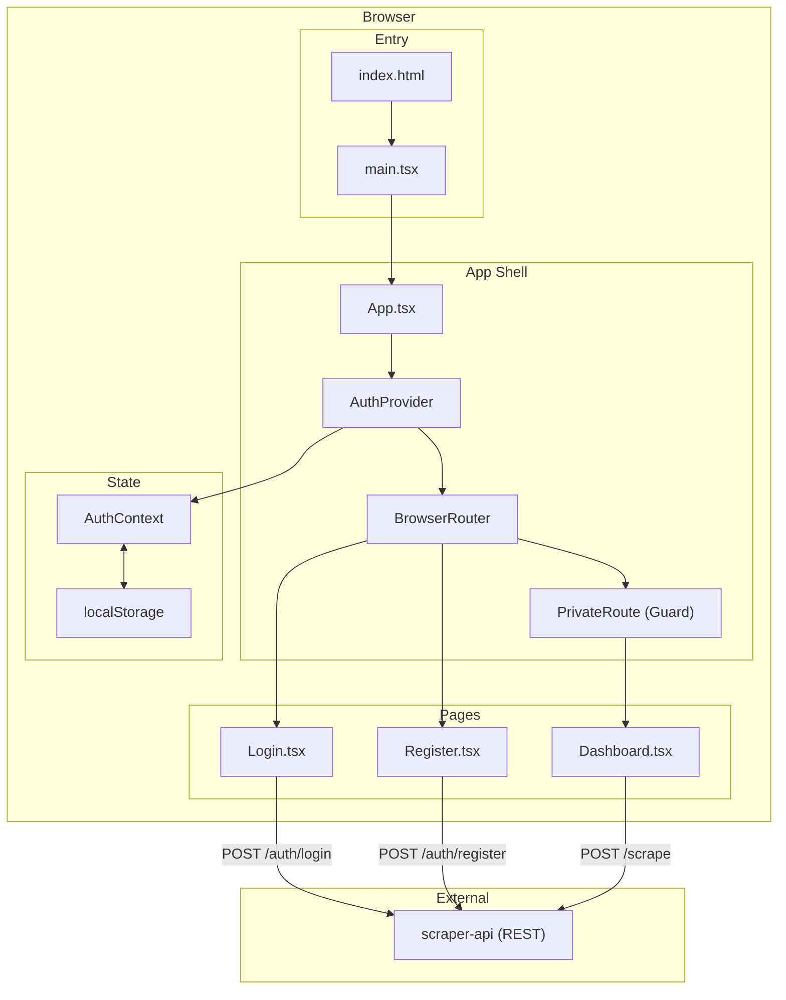
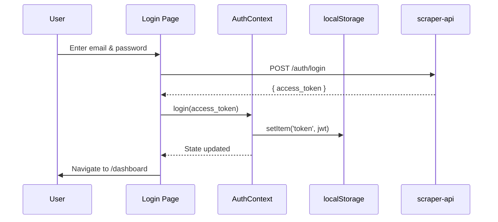
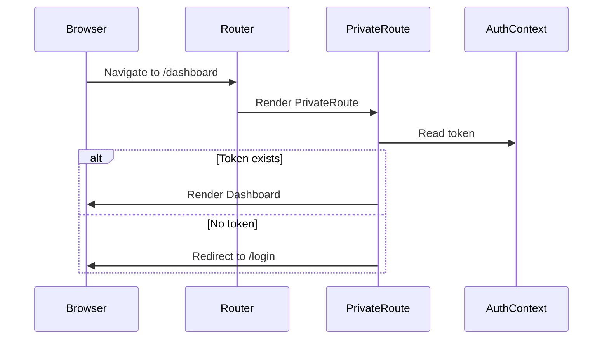
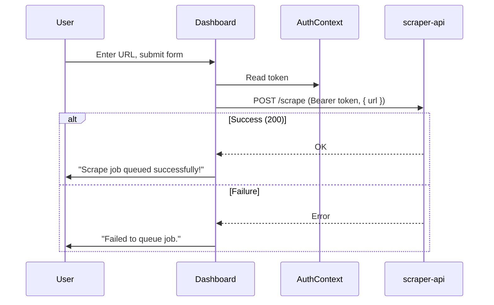

# Web Application Architecture

## Overview

The `web` application is a **React 19 SPA** served as static assets. It follows a minimal, flat architecture organized around **pages**, a single **context provider** for authentication, and direct API calls via `fetch`.

## Architectural Diagram

## Layers

### 1. Entry Layer
- `index.html` — Static HTML shell with a `
` mount point.
- `main.tsx` — Calls `createRoot` and renders `<App />` inside `<StrictMode>`.

### 2. App Shell Layer
- `App.tsx` — Composes the authentication provider and the router. Defines all routes and wraps protected routes with `PrivateRoute`.
- `PrivateRoute` — A guard component that checks for a valid auth token before rendering children.

### 3. Context Layer
- `AuthContext.tsx` — Provides authentication state (`user`, `token`, `login`, `logout`) to the entire component tree via React Context.

### 4. Pages Layer
Each page is a self-contained component responsible for its own form state, API calls, and error handling. Pages consume `AuthContext` via the `useAuth` hook.

| Page | Responsibilities |
| :--- | :--- |
| `Login` | Collects credentials, calls `/auth/login`, stores JWT via `login()`, navigates to dashboard. |
| `Register` | Collects credentials, validates password length, calls `/auth/register`, navigates to login. |
| `Dashboard` | Displays user info, provides scrape URL form, calls `/scrape` with JWT bearer token, provides logout. |

## Data Flow

### Authentication Flow

### Route Guard Flow

### Scrape Request Flow

## Key Design Decisions

### No state management library
The app uses React Context + `useState` instead of Redux or Zustand. This is sufficient for the current scope (single context: authentication) and avoids dependency overhead.

### No API abstraction layer
API calls are made directly with `fetch` inside page components. There is no centralized API client or service module. This keeps the codebase minimal but means the base URL (`http://localhost:3000`) is repeated across components.

### JWT-only authentication
The app stores JWT tokens in `localStorage` and decodes them client-side via `jwt-decode` to extract user info. There is no refresh token mechanism; the session ends when the token expires (60 min, set by the backend).

### Dark-first design system
All styling uses CSS custom properties defined in `index.css`, defaulting to a dark color scheme. There is no light mode toggle.

### Static serving in production
The production build outputs static HTML/CSS/JS assets that are served by Nginx. There is no server-side rendering, API proxy, or Node.js runtime in production.
