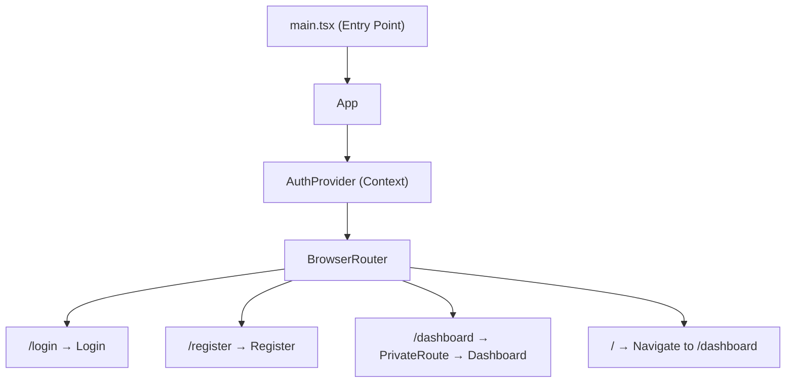
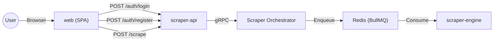

# Web Application Specification

## 1. Overview
The `web` application is a client-side Single Page Application (SPA) built with **React 19** and **Vite**. It serves as the frontend for the scraping platform, providing user authentication (registration & login) and a protected dashboard where authenticated users can submit URLs for scraping. It lives inside the **pnpm monorepo** under `apps/web/` and communicates with the `scraper-api` backend over HTTP.

> [!NOTE]
> The web app is a purely client-side application. It does not perform any server-side rendering (SSR) and is served as static assets in production via Nginx.

## 2. Architecture

### Pattern
Component-based React SPA following the **Pages + Context** pattern. Global state is managed via React Context, and routing is handled by `react-router-dom` with a client-side `BrowserRouter`.

### Component Tree



### Pages

| Page | Route | Auth Required | Description |
| :--- | :--- | :--- | :--- |
| `Login` | `/login` | No | Email/password login form. On success, stores JWT and redirects to `/dashboard`. |
| `Register` | `/register` | No | Email/password registration form. Validates password length (≥ 8 chars). On success, redirects to `/login`. |
| `Dashboard` | `/dashboard` | Yes | Displays logged-in user's email, a URL input to submit scrape jobs, and a logout button. |

### Route Protection
The `PrivateRoute` component wraps protected routes. It reads the `token` from `AuthContext`:
- If a token exists → renders the child component.
- If no token → redirects to `/login` via `<Navigate>`.

The root path (`/`) redirects to `/dashboard`, which in turn redirects unauthenticated users to `/login`.

## 3. Technology Stack

### Runtime & Build
| Tool | Version / Detail |
| :--- | :--- |
| **Vite** | ^7.2.4 |
| **TypeScript** | ~5.9.3, target `ES2022`, module `ESNext`, bundler resolution |
| **React** | ^19.2.0 |
| **React DOM** | ^19.2.0 |
| **Package Manager** | pnpm (monorepo with `pnpm-workspace.yaml`) |

### Core Libraries
| Package | Version | Purpose |
| :--- | :--- | :--- |
| `react-router-dom` | ^7.10.1 | Client-side routing |
| `jwt-decode` | ^4.0.0 | Decode JWT tokens to extract user info |

### Dev & Quality Tools
| Tool | Purpose |
| :--- | :--- |
| `vitest` ^4.0.16 | Unit test runner |
| `jsdom` ^27.4.0 | DOM environment for tests |
| `@testing-library/react` ^16.3.1 | React component testing utilities |
| `@testing-library/jest-dom` ^6.9.1 | Custom DOM matchers |
| `@testing-library/user-event` ^14.6.1 | User interaction simulation |
| `@testing-library/dom` ^10.4.1 | Low-level DOM testing utilities |
| `eslint` ^9.39.1 + `typescript-eslint` | Linting |
| `eslint-plugin-react-hooks` | React Hooks lint rules |
| `eslint-plugin-react-refresh` | React Refresh lint rules |

## 4. State Management

### AuthContext
The `AuthContext` is the single global state provider. It manages:

| Property | Type | Description |
| :--- | :--- | :--- |
| `user` | `User \| null` | Decoded JWT payload (`email`, `sub`). Derived via `useMemo` from the token. |
| `token` | `string \| null` | Raw JWT string. Initialized from `localStorage` on mount. |
| `login(token)` | `(string) => void` | Stores the token in state (and syncs to `localStorage`). |
| `logout()` | `() => void` | Clears the token from state and `localStorage`. |

### User Interface
```typescript
interface User {
    email: string;
    sub: number;
}
```

### Persistence
- The JWT token is persisted to `localStorage` under the key `'token'`.
- On app load, the `AuthProvider` lazily initializes state from `localStorage`.
- On `logout()`, the token is removed from `localStorage`.

## 5. API Communication

All API calls are made via the native `fetch` API to the `scraper-api` backend at `http://localhost:3000`.

| Action | Method | Endpoint | Auth | Request Body | Response |
| :--- | :--- | :--- | :--- | :--- | :--- |
| Login | `POST` | `/auth/login` | None | `{ email, password }` | `{ access_token }` |
| Register | `POST` | `/auth/register` | None | `{ email, password }` | — |
| Scrape | `POST` | `/scrape` | `Bearer` token | `{ url }` | — |

> [!IMPORTANT]
> The API base URL (`http://localhost:3000`) is hardcoded in each page component. This should be extracted to an environment variable for production deployments.

## 6. Client-Side Validation

| Page | Field | Rule |
| :--- | :--- | :--- |
| Register | `password` | Minimum 8 characters (checked before API call) |
| Login | `email` | HTML5 `type="email"` + `required` attribute |
| Login | `password` | `required` attribute |
| Dashboard | `url` | HTML5 `type="url"` + `required` attribute |

## 7. Design System

### CSS Variables (Dark Theme)
```css
--color-bg:            #0f172a    /* Page background */
--color-surface:       #1e293b    /* Card / panel background */
--color-primary:       #3b82f6    /* Buttons, focus rings */
--color-primary-hover: #2563eb    /* Button hover state */
--color-text:          #f8fafc    /* Primary text */
--color-text-muted:    #94a3b8    /* Secondary / dimmed text */
--color-border:        #334155    /* Input borders */
--color-error:         #ef4444    /* Error messages, logout button */
```

### Typography
- **Font Stack**: `'Inter', system-ui, Avenir, Helvetica, Arial, sans-serif`
- **Font Weight**: `400` (regular)
- **Line Height**: `1.5`
- **Rendering**: `optimizeLegibility`, anti-aliased

### Global Component Styles
- **Buttons**: `8px` border-radius, primary background, `0.25s` transitions on hover.
- **Inputs**: `8px` border-radius, surface background, `2px` primary focus ring.
- **Layout**: `max-width: 1280px`, centered with auto margins.

## 8. Project Structure

```
apps/web/
├── public/
│   └── vite.svg                  # Favicon
├── src/
│   ├── assets/
│   │   └── react.svg
│   ├── context/
│   │   └── AuthContext.tsx        # Global auth state (JWT + user)
│   ├── pages/
│   │   ├── Dashboard.tsx          # Protected dashboard (scrape form)
│   │   ├── Login.tsx              # Login page
│   │   └── Register.tsx           # Registration page
│   ├── test/
│   │   └── setup.ts              # Vitest setup (jest-dom matchers)
│   ├── App.css                   # App-level styles (legacy Vite defaults)
│   ├── App.test.tsx              # App-level tests
│   ├── App.tsx                   # Root component (routing + auth provider)
│   ├── index.css                 # Global styles (variables, resets)
│   └── main.tsx                  # Entry point (ReactDOM.createRoot)
├── Dockerfile                    # Multi-stage build (Vite → Nginx)
├── eslint.config.js              # ESLint flat config
├── index.html                    # HTML shell (Vite entry)
├── package.json                  # Dependencies & scripts
├── tsconfig.json                 # Root TS config (references)
├── tsconfig.app.json             # App TS config
├── tsconfig.node.json            # Node TS config (Vite)
└── vite.config.ts                # Vite + Vitest config
```

## 9. Scripts

| Script | Command | Purpose |
| :--- | :--- | :--- |
| `dev` | `vite` | Start Vite dev server with HMR |
| `build` | `tsc -b && vite build` | Type-check and build production bundle |
| `preview` | `vite preview` | Preview production build locally |
| `lint` | `eslint .` | Lint all source files |
| `lint:fix` | `eslint . --fix` | Auto-fix lint issues |
| `test` | `vitest run` | Run unit tests (single run) |
| `test:watch` | `vitest` | Run unit tests in watch mode |

## 10. Testing

### Framework
- **Runner**: Vitest with `jsdom` environment.
- **Utilities**: `@testing-library/react` for rendering, `@testing-library/jest-dom` for DOM matchers.
- **Setup**: `src/test/setup.ts` imports `@testing-library/jest-dom` globally.
- **Globals**: Vitest globals are enabled (`globals: true`).

### Existing Tests
- `App.test.tsx`: Verifies that the app renders the Login heading by default (since `/` → `/dashboard` → redirect to `/login`).

## 11. Containerization

### Dockerfile (Multi-stage build)
- **Build stage**: `node:20-slim`, enables corepack/pnpm, installs dependencies, runs `pnpm --filter web build`.
- **Serve stage**: `nginx:alpine`, copies built static assets from `dist/` to Nginx's HTML directory.
- **Exposes**: Port `80`.
- **CMD**: `nginx -g "daemon off;"`

## 12. Relationship with Other Services



- The `web` app is the user-facing frontend that communicates exclusively with `scraper-api` over HTTP/REST.
- Authentication tokens (JWT) issued by `scraper-api` are stored client-side and sent as `Bearer` tokens on protected requests.
- The web app has no direct dependency on Redis, the database, or any other backend service.
